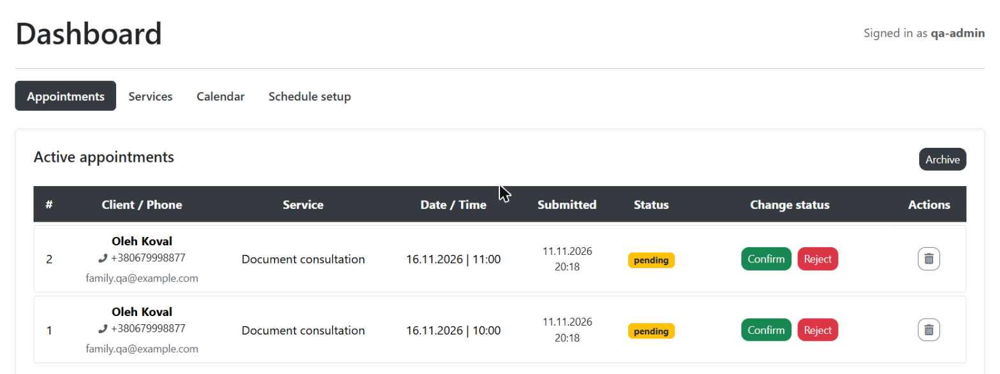

# BUG-001: A new booking with an existing email overwrites the client's name and phone on earlier appointments

| Field | Value |
|---|---|
| **Project** | Booking Website (pet project: online appointment booking, Flask + PostgreSQL) |
| **Component** | Public booking form → Admin dashboard (Active appointments) |
| **Environment** | Local Docker build (`docker compose up`), Windows 11, Chrome, http://localhost:8000 |
| **Build** | `main` branch, 2026-11-11 |
| **Severity** | Major: the admin sees wrong contact details for a real appointment and may call or greet the wrong person |
| **Priority** | High |
| **Reproducibility** | Always (2/2) |
| **Status** | Open |
| **Reported by** | StanUser, 2026-11-11 |

## Summary

The booking form finds clients by email. When a second booking is made with an email that already exists,
the app replaces the stored name and phone of that client. Because all appointments of a client share
these details, the **earlier appointment now shows the new person's name and phone** in the dashboard,
and the original contact details are lost.

A realistic case: two family members share one email, or someone books for a relative using their own email.

## Preconditions

1. The app is running locally; an administrator account exists.
2. A service exists (e.g. "Document consultation").
3. Two free time slots exist on the same working day (e.g. 16.11.2026 at 10:00 and 11:00).
4. No client with the email `family.qa@example.com` exists yet.

## Steps to reproduce

1. Open http://localhost:8000/appointments/book.
2. Fill in the form and submit:
   - Name: `Anna Koval`
   - Email: `family.qa@example.com`
   - Phone: `+380501112233`
   - Service: `Document consultation`, Date: `16.11.2026`, Time: `10:00`
   - Tick "I agree to the privacy policy", click **Book**
3. Log in as admin and open **Dashboard → Appointments**.
   The 10:00 appointment shows **Anna Koval, +380501112233** (correct).
4. Open the booking form again and submit a second booking:
   - Name: `Oleh Koval`
   - Email: `family.qa@example.com` (same email)
   - Phone: `+380679998877`
   - Service: `Document consultation`, Date: `16.11.2026`, Time: `11:00`
5. Refresh **Dashboard → Appointments** and look at the 10:00 appointment.

## Expected result

- The 10:00 appointment still shows **Anna Koval, +380501112233**.
- The 11:00 appointment shows **Oleh Koval, +380679998877**.

Each appointment keeps the name and phone that were entered when it was booked.

## Actual result

Both appointments show **Oleh Koval, +380679998877**.
Anna's name and phone are no longer shown anywhere in the dashboard.

## Additional information

- The "Booking request received" emails in Mailpit were correct at the time of sending
  ("Dear Anna Koval" for the first booking, "Dear Oleh Koval" for the second).
  But every later email about the 10:00 appointment (confirmation, reminder) is built from the
  current client record, so it would greet "Oleh Koval".
- **Observed pattern:** the site treats the email as the identity of a client. Name and phone appear to be stored
  once per email, not per appointment, so the latest booking's details replace the earlier ones.
- **Possible fixes** (for the developer to decide): keep the name and phone with each appointment, or do not
  overwrite existing details and show the admin that the details differ.
- **Related test case:** [TC-05](test-cases.md#tc-05-second-booking-with-the-same-email-keeps-the-first-appointments-details).
